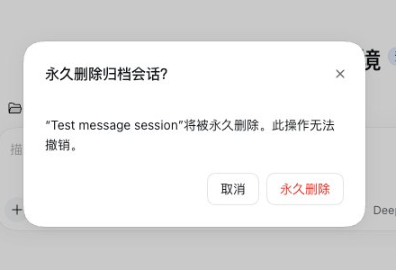

# 归档会话清理（Archived Session Cleaner）

[English](README.md) · **中文**

一个 DeepSeek Harness 插件包，用来**永久删除已归档的会话**。

## 为什么需要它

DSH 把会话日志当作唯一事实来源，本身没有提供删除会话的能力。归档只是把会话从侧栏分组里
藏起来：日志还在磁盘上、还在「已归档」筛选里、还占着工作区的记录。归档的会话越攒越多，
侧栏就越来越乱。这个插件补上了缺的那一步。

## 功能

- 在**已归档**会话行的 `...` 菜单里增加「永久删除会话」。
- 先确认再删，并明确告诉你会删掉什么——会话本身，以及它名下的子智能体日志。
- 删除会话的存储目录、它的投影缓存，以及它名下的子智能体会话。
- 把它从工作区记录和归档集合里摘掉，侧栏里的这一行会立刻消失。
- 同时提供一个智能体工具 `delete_archived_sessions`，与 UI 共用同一份实现。它要求显式
  传入**一个 `sessionId`**——智能体没有「一次删掉所有归档会话」这种模式。



安全边界：只允许删除已归档的会话；正在运行的会话会被拒绝；未归档的 id 会被忽略；删除
不可撤销。

## 环境要求

- DeepSeek Harness 0.2.x，并且运行 Web 界面（开发时使用 `0.2.1-rc.3`）。
- UI 部分是一个 Web 客户端插件，所以 profile 必须启用 Web GUI。

## 安装

### 从 GitHub 安装

设置 → 插件 → 添加，填入：

```
github:zhangfan0529/dsh-archived-session-cleaner
```

或者 `git+https://github.com/zhangfan0529/dsh-archived-session-cleaner.git`。

安装需要授权，底层会运行 `pnpm`。仓库根目录必须就是这个包——即包含
`dsh.bundle.patch` 的那个 `package.json` 所在目录。

### 从本地目录安装

设置 → 插件 → 添加，填这个目录的绝对路径：

```
/Users/you/plugins/dsh-archived-session-cleaner
```

安装完成后刷新一次页面，客户端代码才会加载。

## 使用

1. 如果会话还没归档，先用它的 `...` 菜单 →「归档会话」。
2. 在侧栏筛选里显示已归档会话。
3. 打开归档行上的 `...` 菜单 →「永久删除会话」。
4. 确认。

也可以让智能体删某一条：这个工具要求显式给出会话 id（在归档行的 `...` 菜单里点
「复制 Session ID」），智能体不能一次删掉所有归档会话。

## 工作原理

- **宿主半边**（[index.js](index.js)）负责删除。它注册了一条包内的本机路由
  （`POST /dsh-plugin/archived-sessions`；浏览器调用仅限同源，这条路由本身不是
  带鉴权的 API）给客户端半边用，并注册 `delete_archived_sessions` 工具给智能体用；
  两者调用同一份实现。
- **客户端半边**（[client.js](client.js)）在侧栏注册菜单行和确认弹窗。弹窗优先使用
  Harness 自带的 `Modal`/`Button` 组件，因此和系统弹窗完全一致，浅色/深色主题都跟随；
  如果取不到这个私有模块，则回退到内置实现。
- 路由只在本机回环地址上；浏览器跨站调用会被拒绝，但它不是带鉴权的 API。没有外网请求，
  没有遥测。浏览器碰不到文件系统，所以客户端半边只发送一条命令（`preview` 或 `delete`），
  由宿主进程内执行。

## 会删掉什么

- `$DSH_HOME/sessions/<project>/<sessionId>/` —— JSONL 日志及其附属文件
- `$DSH_HOME/storages/session_projcache/sessions/<sessionId>.json`
- 该会话名下记录的子智能体会话（`origin: "subagent"`）
- 会话在工作区账目中的位置，以及它在归档集合里的条目

`$DSH_HOME` 默认是 `~/.dsh`。

## 说明

- DSH 0.2.x 没有公开的会话删除接口，所以本插件是按上面的存储布局自己实现的。将来 DSH
  如果改了布局、或者提供了删除接口，这个插件可能需要跟着改、甚至可以直接去掉。
- 确认弹窗优先使用 `@deepseek-ai/dsh-client-ui-primitives`，这是 Harness 的私有客户端
  API，版本之间可能变化；取不到时会回退到内置样式。
- 没有构建步骤：纯 ESM，没有运行时依赖。

## 文件

| 文件 | 作用 |
| --- | --- |
| `package.json` | 包清单：`dsh.bundle.patch`、`dsh.client`、exports |
| `cordis.patch.yml` | 插入插件行的 Loader patch |
| `index.js` | 宿主半边：删除实现、本机路由、智能体工具 |
| `client.js` | 客户端半边：菜单行、确认弹窗 |
| `locale/en.json`、`locale/zh.json` | 插件列表里的标题和描述 |
| `icon.svg` | 插件列表图标 |
| `LICENSE` | MIT 许可 |

## 许可

MIT，见 [LICENSE](LICENSE)。`assets/` 下的文件不在 MIT 许可范围内。

## 赞助

[](https://www.feiyutoken.com)

**[飞鱼 Token](https://www.feiyutoken.com)**
